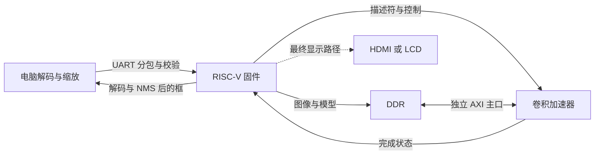

# 静态图像 YOLO 移植评估

本文保留早期选型与 128 MAC/INT32 规划。当前主线已改为原样复用完整上游的 576 路乘积、
18 bit 累加数据通路，接手请先读 [交接文档](HANDOFF.md) 和 [当前接口](UPSTREAM.md)。
下文标注“当前”的 hgb 快照及 128 MAC 选择属于该次评估，不能视为最新实现状态。

核对日期：2026-10-23。当前选择 **YOLOX-Tiny 为主、Nano 为备选**，采用软核调度、
INT8 卷积加速、DDR 存放模型与特征的路线。板卡容量、候选资源证据和排序见
[选型报告](ACCELERATOR_SELECTION.md)。本文保留赛题、接口、数值约束和原有矩阵 tile 契约。
完整板端推理与板级可行性仍需后续实现和测量。

用户已确定 adamgallas 128 MAC；当前卷积后端的实现、接口和 Verilator 结果见
[ADAM128.md](ADAM128.md)。本文件后面的 systolic tile 段落属于保留的原始参考实现。
当前已实现 [图片联合仿真](IMAGE_SIM.md)，Tiny 的全部卷积在 RTL 执行，其他算子由电脑执行。

## 赛题与已有工程

已阅读上级 `HANDOVER.md`、`OPTIMIZATION_PLAN.md`、`ITERATIONS.md` 的当前进展、
B19/B20 及 Flash/NPU/DDR 规划。`0501f10` 是 P1+P2 集成点；最新只读核对时，
hgb 为 `soc/p2-p3-clock-study@e088a9d`，生产 RTL 提交为 `1a4f8fa`。
当前组合尚无 PDS 结果，不将旧 P0 的物理结果用于估算当前剩余资源。

本地 `紫光.pdf` 的选题一，高阶任务第 3 项位于 PDF 第 10 页、印刷第 8 页：
要求 RISC-V、边缘 AI 加速、移植 YOLO 或轻量大模型，并“融合一种或者多种传感器或者显示设备”。
下一页要求评估应用延迟、识别率以及资源、时序、主频。

该项未限定摄像头输入，静态图像传入适合作为初期实现；建议最终加 HDMI/LCD 显示检测结果。
仅在电脑窗口显示是否满足“显示设备”，文件没有明确解释，需向赛方确认。
选题二的实时视频要求属于另一个选题，不能混用。YOLO 在这里执行多目标检测，
输出类别和框；若后续只做整图分类，需要另行确定模型和评价方式。

PDF 的盘古 676 平台有 100K/200K 型号；本地 Pango 脚本选择
`PG2L200H-6IFBB676`。PDF 型号文字与工程封装字符串不同，最终以实物、器件手册及
PDS 库为准。200HP 手册的 LUT6/APM/DRM、Flash 和 DDR 数据已补入选型报告；没有运行 PDS。

## 当前选型

模型以官方 YOLOX-Tiny 为主，已确定采用 adamgallas 的 128 MAC 适配版本，
FIE 与小配置 NVDLA 保留作方案对比。详细证据、资源门槛、tiny 系列仓库消歧和算子差异见
[选型报告](ACCELERATOR_SELECTION.md)。已有自研 tile 保留作独立算术参考，
不把矩阵仿真成功作为选定完整加速器的依据。后续导入第三方代码时固定提交并保留许可。

## 原有 Nano 软件参考

上游固定为 `6ddff4824372906469a7fae2dc3206c7aa4bbaee`。
`tools/audit_yolox.py` 现支持 Nano/Tiny，CPU eval 前向并按 Conv2d 的实际输出形状计数。
以下保留首次 Nano 分析；Tiny 与对比结果在 `reports/model-comparison.json`。
训练损失模块虽然出现在模块清单中，不进入推理算子清单；函数形式的 Add/Concat/Sigmoid
不能只靠模块数量判断是否存在，仍按上游 `network_blocks.py`、`yolo_head.py` 核对。

| 指标 | 320×320 | 416×416 |
| --- | ---: | ---: |
| 输入 UINT8 字节 | 307,200 | 519,168 |
| 普通空间卷积 MAC | 44,236,800 | 74,760,192 |
| 深度卷积 MAC | 11,059,200 | 18,690,048 |
| 1×1 卷积 MAC | 253,907,200 | 429,103,168 |
| 卷积总 MAC | 309,203,200 | 522,553,408 |
| 最大单个卷积输出元素 | 409,600 | 692,224 |
| 未进行框解码的输出形状 | 1×2100×85 | 1×3549×85 |

总参数 912,159，卷积权重元素 896,512；每个卷积权重存 INT8 时约 0.855 MiB，
还需 bias、scale、查表与描述符。官方 checkpoint 文件还包含其他内容，大小不能当作
板上 INT8 权重容量。最大单个输出也不是峰值活跃内存；残差、Concat、双缓冲和 INT32
部分和需做生命周期分配，不能按“两张特征图”直接得出 DDR 峰值。

1×1 占卷积 MAC 的 82.117%，深度卷积占 3.577%，两种尺寸比例相同。
这说明原有 Nano 路线重点在 1×1。当前 Tiny 的普通空间卷积占主要计算量，选核与取数
应同时覆盖 1×1 和 3×3，避免在 DDR 中完整展开 im2col。
深度卷积避免转成大量零元素的稠密矩阵，后续使用逐通道并行 MAC 或专门的 lane 模式。

预训练权重在官方 `assets/dog.jpg` 上完成 CPU FP32 推理，阈值 0.25、NMS IoU 0.45：
得到 dog、bicycle、car 三个检测，置信度约 0.855、0.803、0.798，原图坐标见
`../reports/dog-reference.json`。这是 PC 软件参考，不是 INT8、RISC-V 或 FPGA 测量。
没有运行 COCO val2017 或完整 INT8 校准。

## 算子与数值路径

| 运算 | 计划实现与需检查的细节 |
| --- | --- |
| Conv1×1、普通 Conv3×3 | INT8 乘法、INT32 累加；tile 分块，跨 K 块的部分和需另有存储 |
| Depthwise3×3 | 通道独立取数/累加，避免稠密 GEMM 的空算 |
| Conv+BN | 离线折叠；每输出通道权重量化，bias/scale 独立导出 |
| SiLU | 校准后按层/共享量化域查表；不能直接换成 ReLU 并继续使用原精度结论 |
| Focus | 按官方切片顺序重排地址；顺序是左上、左下、右上、右下 |
| SPP MaxPool | 5/9/13 核、stride1、对应 padding；边界需与浮点参考一致 |
| Add/Concat | 分支量化 scale 对齐；Concat 后各通道与后继权重顺序一致 |
| Resize | 最近邻，核对倍率、布局和边界 |
| Sigmoid、框解码、NMS | 初版由软核执行；先验证定点或软件浮点代价，再决定进一步下沉 |

官方默认预处理是 OpenCV BGR、等比例缩放至左上角、右侧/下侧填 114、CHW，
转 float 后保持 0..255 数值；没有默认除以 255，也没有默认换 RGB。参考脚本直接调用
上游预处理，避免把 YOLOv5 的居中 letterbox 或 RGB 流程混入。

UART 可先传 UINT8 CHW；进入 signed INT8 tile 前，必须按导出的 scale/zero-point
量化。将 128..255 字节直接解释为负数会改变模型。选择非零 zero-point 时，需处理
卷积校正项与 padding 的真实零值；本版 tile 只计算原始 signed GEMM，不自动完成这些步骤。
INT32 输出还需定义舍入、右移、饱和、bias 与激活次序，逐层与软件整数参考比对。

## 数据路径与现有 SoC 对接

软核运行静态 C 算子执行器和设备驱动，不把 PyTorch/ONNX Runtime 直接搬进当前裸机或
RT-Thread。PC 参考模型仅用于对照；正式演示的识别在软核控制的 FPGA 系统内完成。

只读核对到的接口如下，后续集成前必须重新核对正在变化的 P2/P3 分支：

| hgb 现有对象 | 含义与缺口 |
| --- | --- |
| `soc_system.external_req/external_rsp` | 外部设备作为 AXI 主端接入系统，适合未来 NPU DMA |
| `soc_system.npu_req/npu_rsp` | 系统访问 NPU SRAM 的目标口；`npu_req` 是 SoC 输出，不能误接为 NPU 读 DDR 的主口 |
| `axi_types_pkg` | 32 位地址、256 位 AXI 数据、4 位 ID；控制 AXI-Lite 为 64 位数据 |
| `NPU_CTRL_BASE=0x10060000` | 已预留地址常量；当前没有可直接对接的完整 NPU CSR 端点 |
| `NPU_SRAM_BASE=0x20000000` | 已预留目标窗口，默认 `NPU_BYTES=0`；实际容量和 ownership 需实现 |
| 完成 IRQ | 当前无专用 NPU 完成线路；先规划轮询，后续单独扩展 IRQ/CDC |

建议 NPU 数据面先工作在 `clk_sys`，以后再按测量决定独立时钟。AXI AW/W 独立握手，
读写响应报错、背压保持、burst 边界和在途复位都需定向测试；CSR 写使用实际 WSTRB，
同时兼容 RV32/RV64。不得用 UART 接收结束信号直接驱动 start；由固件校验帧与缓冲区后下单。

CPU Cache 与加速器 DDR 访问无硬件一致性。输入/权重移交前 clean；设备将写入的
输出缓冲在移交前须处理 dirty 行，完成后 invalidate；共享缓冲按 cache line 对齐并隔离。
同时需要内存屏障、DMA 完成与写响应确认；只有 fence 不能替代 cache 维护。
TCM 保留给控制、栈和中断，不将完整模型/大特征挤入 64 KiB DTCM。

## UART、存储和性能预算

先采用不压缩的预处理图像，降低板上 JPEG 解码成本。建议协议包含版本、模型 ID、帧号、
宽高/布局、长度、序号、CRC32，以及逐块 ACK/重试和超时；损坏、越界与重复包不能启动推理。
权重开机上传一次并常驻 DDR，图片逐张上传。协议及串口收发程序尚未实现。

8N1、每字节 10 bit，仅计算有效载荷的理想传输下界：

| 图像 | 115200 baud | 921600 baud | 3 Mbaud |
| --- | ---: | ---: | ---: |
| 320×320×3 | 26.67 s | 3.33 s | 1.024 s |
| 416×416×3 | 45.07 s | 5.63 s | 1.731 s |

实际还有包头、ACK、驱动等待与重传。921600/3M 是否稳定须按时钟分频、USB 串口和板线
实测；先用 115200 建链，再提速。单张静态演示可以等待传输，连续测试性能时应将图像
预装 DDR，单独测推理，报告时也必须给出含 UART 的端到端延迟。

候选先评估 64/128 MAC，再按资源检查决定是否增加到 256；APM 映射由 PDS 决定。
以假设 100 MHz、64 MAC 每拍全利用为例，416 的 Nano/Tiny 纯卷积下界约 81.65/500.98 ms，
它忽略填排、深度卷积利用率、DDR、激活和软核处理，不能写成实测帧率或时序承诺。
目前没有该模块的 APM/LUT/DRM 消耗与 Fmax；必须在当前 SoC 同源配置下测量资源余量。

原有自研 tile 曾按约 40 KiB 设计小缓存预算，尚未实现 RAM。引入现成卷积核后，
按其取数和端口要求重新分配片上缓存，不套用这项旧预算；完整活跃特征放 DDR。
不复用现有 CoreMark 固定工作区地址，未来由固件分配不重叠的模型/输入/输出区域。

## 原有 systolic tile 契约与验证

`systolic_tile` 是 output-stationary 阵列：A 向右、B 向下，每 PE 保存一个 INT32 和。
ROWS/COLS 为正整数，默认 4×4；一条命令给出 K，合法范围 1..65535。
K=0 时 `cmd_ready=0`，调用者必须报错，不能一直等待非法任务。当前不支持 bias、累加到旧结果
或跨 K 块接续；一条命令始终清零部分和。

1. `cmd_valid && cmd_ready` 清空旧阵列状态并锁存总步数。
2. 第 t 个 `in_valid && in_ready` 步：左侧第 r 行输入 A[r,t-r]，顶部第 c 列输入 B[t-c,c]；
   下标越界时 lane valid=0。A/B 属于同一输入步，取数器必须共同准备好再提交。
3. 总计接收 `K+ROWS+COLS-2` 步，包括尾部排空。`in_valid=0` 时数据、有效位、部分和与计数全停。
4. 最后一步后 `out_valid=1`，结果保持至 `out_ready`；期间不接收新命令或数据。
5. 同步 reset 丢弃当前任务。外部驱动负责超时/重试；此 tile 不处理 AXI 在途事务。

本次 `make test` 四配置各 101 个 GEMM，合计 404 个，另在每配置内检查零 K、忙时命令、
输入气泡、5 拍结果背压、计算中复位后的新任务。参考值通过普通三重循环计算，
不复用 RTL 的错位时序。seed 固定为十六进制 `20261023`，包含负数、-128×-128、
127×-128、零矩阵和 K=65535。该 K 上界的最坏单项累加仍在 INT32 范围。
`make lint` 严格通过；原始命令、编译日志、运行日志及源 SHA 在 `build/sim/`。

本仓库模块不含 XLEN 分支，所以测试按阵列维度展开。hgb 没有代码变更，不运行其 Core/SoC
回归；未来控制口与驱动接入时必须补 RV32/RV64。PDS/ILA/板级 DDR/UART 尚未运行，
矩阵验证不代表完整卷积调度或网络推理通过。

## 后续实施顺序

| 检查点 | 开发内容 | 进入下一步的条件 |
| --- | --- | --- |
| 0：候选适配 | 对照上游核的打包乘法、位宽、RAM/SRL 和流水契约；Pango 单核综合 | 算术/缓存对比通过，达到选型报告资源门槛后推进完整移植 |
| 1：数值参考 | 固定 416 官方精度基线；320 作为降负载候选；BN 折叠、INT8 校准与逐层整数模型 | 同一验证集报告 FP32/INT8 AP 与误差，讨论可接受降幅；不可沿用 416 的 AP 标注 320 |
| 2：完整算子 | Tiny 分块取数、1×1/3×3/stride-2、bias/requant/SiLU/SPP/Add/Resize；Nano 才需深度卷积 | 边界尺寸、padding、溢出与随机背压逐层对比，最终检测框对齐 |
| 3：独立设备 | banked SRAM、描述符、AXI 主口、控制口、轮询驱动 | 存储模型下背压/错误/4KiB burst/复位通过，记录搬运与计算周期 |
| 4：静态图像链路 | 分包协议、固件、PC 发图和结果显示 | CRC/超时/重复包验证，通过多张图片；软核+NPU 完整推理 |
| 5：受控集成 | 待 hgb P2/P3 接口稳定并获得后续集成授权，再接实际 SoC | 当前双宽功能、Cache 移交、后台带宽；PDS 资源/时序；最后板级与显示 |

优先实现检测链路的完整性，再调阵列规模和 DDR 复用。延迟分为预处理、上传、排队、
DMA、加速器、软核解码/NMS、回传和显示，各项使用真实时间与清楚的计数边界。
